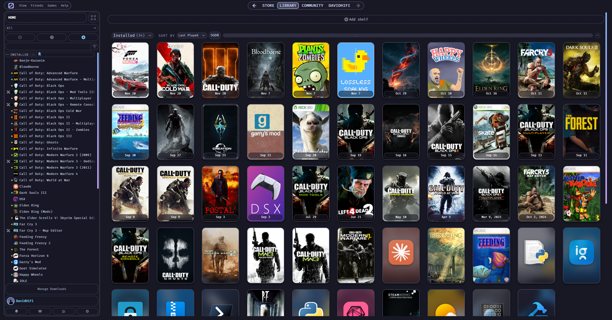

<div align="center">



# Mocha Steam

**A Catppuccin Mocha theme for the Steam client on [Millennium](https://steambrew.app), with frosted menus and glass.**

The theme, its desktop fixes plugin, and a setup script that copies my whole Millennium setup: every plugin, the theme and my settings.

<a href="https://github.com/DavidHiFi/MochaSteam/releases/latest">

</a>
<a href="https://discord.gg/PETWgTfS9x">

</a>

<br><br>


<a href="https://github.com/DavidHiFi/MochaSteam/releases/latest"></a>

</div>

---

## Installation

### Theme and desktop fixes plugin

1. Install [Millennium](https://docs.steambrew.app/users/getting-started/installation).
2. [Download the latest release](https://github.com/DavidHiFi/MochaSteam/releases/latest) and extract it.
3. Exit Steam.
4. In the extracted folder, run:

   ```powershell
   powershell -NoProfile -ExecutionPolicy Bypass -File .\install.ps1 -Apply -Configure
   ```

5. Start Steam. Mocha Steam is selected and MochaSteam Desktop Fixes is on.

Without `-Apply`, `install.ps1` only shows what it would do. Add `-SteamPath 'D:\Steam'` if Steam lives somewhere else.

### The whole setup

This copies my exact setup. It installs Millennium if it is missing, the theme, 23 plugins, my theme options and my plugin settings. Run it in Windows PowerShell:

```powershell
irm https://raw.githubusercontent.com/DavidHiFi/MochaSteam/main/setup/Install-MochaSetup.ps1 | iex
```

1. If Millennium is missing, the official Millennium installer opens. Click through it.
2. The script closes Steam, installs everything and merges your Millennium config after backing it up.
3. Start Steam when it finishes.
4. Install the three plugins listed under [Three plugins to install by hand](#notes) to match my setup exactly.

To read the plan before anything changes, download the script and run it in audit mode:

```powershell
Invoke-WebRequest https://raw.githubusercontent.com/DavidHiFi/MochaSteam/main/setup/Install-MochaSetup.ps1 -OutFile Install-MochaSetup.ps1
powershell -NoProfile -ExecutionPolicy Bypass -File .\Install-MochaSetup.ps1 -Audit
```

Add `-SteamPath 'D:\Steam'` for a Steam folder elsewhere, or `-SkipMillenniumInstall` to stop the script from starting the Millennium installer.

<details>
<summary><b>Theme only, by hand</b></summary>

<br>

1. Install [Millennium](https://docs.steambrew.app/users/getting-started/installation).
2. [Download the latest release](https://github.com/DavidHiFi/MochaSteam/releases/latest), extract it and exit Steam.
3. Copy what is inside `themes\mocha-steam` to `Steam\millennium\themes\MochaSteam`, so `skin.json` sits in that folder.
4. Start Steam and pick **Mocha Steam** in Millennium's Themes tab.

Leave **Mica & Acrylic plugin support** off this way. The frosted menu windows come from the desktop fixes plugin.

</details>

## Features

### Look

- **Catppuccin Mocha:** the Mocha palette with blue and mauve accents, across Library, Store, Community, settings, friends and chat.
- **Rounded controls:** cards, menus, dropdowns, buttons and the library frame keep their corners.
- **Hover rings:** every hover gets the same 2px blue to mauve edge, with no jump in size.
- **Frosted menus:** menus, dropdowns, tooltips, dialogs and the sticky Store bar blur what sits behind them.
- **Fluent icons:** one icon set across the top bar, user panel and plugin buttons.

### Library

- **Tidy rows:** game icons, ProtonDB dots and non-Steam entries line up in one column.
- **Resizable sidebar:** drag its edge, and the width is kept.
- **Library frame:** the sidebar, the Downloads bar and the user panel sit inside one frame below the top bar.
- **Downloads sidebar:** your games list stays beside the Downloads page.
- **Narrow windows:** the top bar keeps its pills lined up when you shrink Steam.

### Options and plugins

- **SpaceTheme options:** sidebar position and hover mode, fonts, window controls, an auto-hide menu, gift-card visibility and favourite-friend status backgrounds.
- **Plugin styling:** matching looks for plugins such as Size on Disk, ProtonDB badges, HLTB and Extendium.
- **Desktop fixes plugin:** real Windows frosted glass behind Steam's separate menus and desktop pop-ups, and Friends stays closed at startup.

### Setup script

- **Plugins:** installs 23 plugins at the versions pinned in [setup/manifest.json](setup/manifest.json), and turns on the same ones I use.
- **Settings:** copies my theme options, colours, Millennium settings and every plugin's settings, merged into yours.
- **No personal data:** no keys, logins, friend lists, play history or file paths are included.
- **Safe re-runs:** backs up your config and keeps plugin data such as the Gratitude friend list.

## Notes

> [!IMPORTANT]
> **The see-through main window needs more than this repo.** Frosted menus and pop-ups need Windows 11 with transparency effects on. On my PC the main window is see-through thanks to a Windhawk title bar mod as well. Without one, turn off **Mica & Acrylic plugin support** in the theme options and the main window is a solid dark theme.

> [!NOTE]
> **Fonts are not included.** The default font is Be Vietnam Pro. Install it, or pick a font you have in the theme options.

> [!NOTE]
> **One repo since November 2026.** This repo was called millennium-stuff, and the theme used to sit in a second repo with `skin.json` at its root. Both are here now. The old setup command and old millennium-stuff links still work.

> [!WARNING]
> **Steam updates can break parts of the theme.** Selectors and popup behavior change between Steam versions. [Open an issue](https://github.com/DavidHiFi/MochaSteam/issues/new) with a screenshot and your Steam and Millennium versions when something looks wrong.

<details>
<summary><b>Three plugins to install by hand</b></summary>

<br>

These plugins publish no license, so this repo does not include their code. Install each one from Millennium's plugin store, or from its repository at the commit below. Millennium enables them once they are in place, because the config already lists them.

| Plugin | Repository | Commit |
| --- | --- | --- |
| `adamraichu.auto-accept-custom-launch-args` | [AdamRaichu/auto-accept-custom-launch-args](https://github.com/AdamRaichu/auto-accept-custom-launch-args) | `084d32b` |
| `browser_history` | [ricewind012/steam-browser-history](https://github.com/ricewind012/steam-browser-history) | `8214f36` |
| `easy-restart-reload-for-steam` | [SaiyajinK/Easy-Restart-Reload-for-Steam](https://github.com/SaiyajinK/Easy-Restart-Reload-for-Steam) | `01f10fd` |

The auto-accept plugin turns off a Steam safety prompt for custom launch arguments. Read its README before you install it.

</details>

<details>
<summary><b>What the setup script does not copy</b></summary>

<br>

- **Lua Tools Collection:** my plugin for SteamTools Lua scripts lives in [luatools-collection](https://github.com/DavidHiFi/luatools-collection) and is not installed.
- **Personal data:** Steam friend lists, Gratitude data, non-Steam playtime sessions, the list of installed Windows apps and proxy settings stay on my PC.
- **Steam's own state:** your account, library and window positions are not part of the setup.

Every plugin with its source and version is listed in [NOTICE.md](NOTICE.md).

</details>

<details>
<summary><b>Repo layout</b></summary>

<br>

| Path | What it is |
| --- | --- |
| `themes/mocha-steam/` | The theme, with `skin.json` at the top of that folder. This is the only copy. |
| `plugins/mochasteam-material/` | MochaSteam Desktop Fixes, the plugin both installers copy. |
| `install.ps1` | Installs the theme and the desktop fixes plugin from a downloaded release. |
| `setup/` | The full-setup script, its plugin manifest, config templates and vendored MIT plugins. |
| `configs/` | An example Millennium config and the SpaceTheme commit the theme is synced to. |
| `docs/` | Notes on the theme and where its glass comes from. |

</details>

## Contributing

Reports of Steam updates that break the theme help the most, with a screenshot, along with pull requests for pages the theme misses and fixes to the setup script.

<a href="CONTRIBUTING.md">

</a>

## Star history

Thanks for the stars, the Steam client reports and the plugin fixes.

<a href="https://www.star-history.com/?repos=DavidHiFi%2FMochaSteam&amp;type=date">
  <picture>
    <source media="(prefers-color-scheme: dark)" srcset="https://api.star-history.com/chart?repos=DavidHiFi/MochaSteam&amp;type=date&amp;theme=dark&amp;legend=top-left" />
    <source media="(prefers-color-scheme: light)" srcset="https://api.star-history.com/chart?repos=DavidHiFi/MochaSteam&amp;type=date" />
    
  </picture>
</a>

## Credits

- **Author:** Myself, [DavidHiFi](https://github.com/DavidHiFi)

<!-- contributors:start -->
- **AI coding agents:** [Claude Code](https://github.com/anthropics/claude-code), [OpenCode](https://github.com/anomalyco/opencode) and Halo Sparks

<p>
  <a href="https://github.com/DavidHiFi"></a>
  <a href="https://github.com/anthropics/claude-code"></a>
</p>

<sub>GitHub's contributor list also shows openhands-agent. Our machines had the wrong git name set from late October to November 26, 2026, so some commits by the agents above carry that name. OpenHands did not work on this project.</sub>
<!-- contributors:end -->

| Who | What |
| --- | --- |
| **SpaceEnergy** ([SpaceTheme for Steam](https://github.com/SpaceTheme/Steam)) | Mocha Steam is a fork of SpaceTheme (MIT), synced through commit `ce67165` with later fixes ported by hand, including ForgottenHero's hover-sidebar fix and EldinBegano's dropdown styling. |
| **Catppuccin** ([catppuccin](https://github.com/catppuccin/catppuccin)) | The Mocha colour values (MIT). |
| **Microsoft** ([Fluent UI System Icons](https://github.com/microsoft/fluentui-system-icons)) | The icon font that SpaceTheme ships (MIT). |
| **luthor112** ([GitHub](https://github.com/luthor112)) | Steam Collections Plus, Steam EasyGrid, Steam Librarian and Steam Taskbar Progress, included in `setup/vendor/` (MIT). |
| **veygax** ([valve-internal-enabler](https://github.com/veygax/valve-internal-enabler)) | Included in `setup/vendor/` (MIT). |
| **xwxfox** ([millennium-uwp-library-sync](https://github.com/xwxfox/millennium-uwp-library-sync)) | UWP Library Sync, included in `setup/vendor/` (MIT). |
| **Plugin authors** ([full list](NOTICE.md)) | The 16 plugins the setup script downloads from their own releases, and the three installed by hand. |
| **Steam Client Homebrew** ([PluginDatabase](https://github.com/SteamClientHomebrew/PluginDatabase)) | The approved repositories and commits the plugin manifest is pinned to. |

Built on [Millennium](https://github.com/SteamClientHomebrew/Millennium), with plain CSS and JavaScript for the theme, [Lua](https://www.lua.org) for the desktop fixes plugin and [PowerShell](https://github.com/PowerShell/PowerShell) for the installers.

> Missing or wrong credit? [Open an issue](https://github.com/DavidHiFi/MochaSteam/issues/new) and I'll fix it.

## Disclaimers

Most of this project's code was developed with AI coding agents, mainly Claude Code, with some work from OpenCode and Halo Sparks. I checked each theme change on my own Steam client. The theme started as SpaceEnergy's SpaceTheme, and the plugins belong to their authors.

My changes are MIT, see [LICENSE](LICENSE). SpaceTheme keeps its MIT license in `themes/mocha-steam/`, and every plugin keeps its own license.

<div align="center">
<br>
<sub>Not affiliated with Valve or Steam Client Homebrew. Requires Steam on Windows and <a href="https://steambrew.app">Millennium</a>.</sub>
</div>
