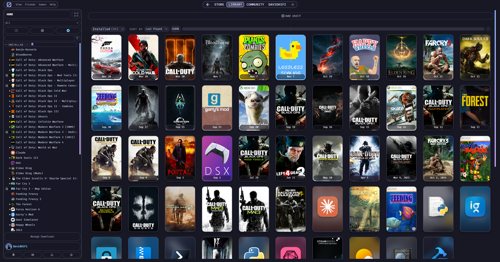

<div align="center">



# Mocha Steam

**A Catppuccin Mocha theme for the Steam client on [Millennium](https://steambrew.app).**

Rounded everything, frosted menus and blue to mauve hover rings, forked from SpaceTheme.

<a href="https://github.com/DavidHiFi/MochaSteam/releases/latest">

</a>

<br><br>


</div>

---

## Installation

### My whole setup (theme, plugins and settings)

[millennium-stuff](https://github.com/DavidHiFi/millennium-stuff) installs this theme with its desktop fixes plugin, every plugin I use and my settings. Run it in Windows PowerShell:

```powershell
irm https://raw.githubusercontent.com/DavidHiFi/millennium-stuff/main/setup/Install-MochaSetup.ps1 | iex
```

It backs up your Millennium config first and keeps your other plugins.

### Theme only

1. Install [Millennium](https://docs.steambrew.app/users/getting-started/installation).
2. [Download the latest release](https://github.com/DavidHiFi/MochaSteam/releases/latest) and exit Steam.
3. Extract the folder that holds `skin.json` to `Steam\millennium\themes\MochaSteam`.
4. Start Steam and pick **Mocha Steam** in Millennium's Themes tab.

## Features

### Look

- **Catppuccin Mocha:** the Mocha palette with blue and mauve accents, across Library, Store, Community, settings, friends and chat.
- **Rounded controls:** cards, menus, dropdowns, buttons and the library frame keep their corners.
- **Hover rings:** every hover gets the same 2px blue to mauve edge, with no jump in size.
- **Frosted menus:** menus, dropdowns, tooltips and the sticky Store bar blur what sits behind them.
- **Fluent icons:** one icon set across the top bar, user panel and plugin buttons.

### Library

- **Tidy rows:** game icons, ProtonDB dots and non-Steam entries line up in one column.
- **Resizable sidebar:** drag its edge, and the width is kept.
- **Downloads sidebar:** your games list stays beside the Downloads page.
- **Narrow windows:** the top bar keeps its pills lined up when you shrink Steam.

### Options

- **SpaceTheme options:** sidebar position and hover mode, fonts, window controls, an auto-hide menu, gift-card visibility and favourite-friend status backgrounds.
- **Plugin styling:** matching looks for plugins such as Size on Disk, ProtonDB badges and HLTB.

## Notes

> [!IMPORTANT]
> **The see-through window needs more than the theme.** Frosted menus and desktop pop-ups come from the MochaSteam Desktop Fixes plugin in [millennium-stuff](https://github.com/DavidHiFi/millennium-stuff). On my PC the main window is see-through thanks to a Windhawk title bar mod as well. Without them, leave **Mica & Acrylic plugin support** off and Mocha Steam is a solid dark theme.

> [!NOTE]
> **Fonts are not included.** The default font is Be Vietnam Pro. Install it, or pick a font you have in the theme options.

> [!WARNING]
> **Steam updates can break parts of the theme.** [Open an issue](https://github.com/DavidHiFi/MochaSteam/issues/new) with a screenshot and your Steam and Millennium versions.

## Contributing

Screenshots of anything a Steam update broke help the most, along with pull requests for pages the theme misses.

<a href="CONTRIBUTING.md">

</a>

## Star history

Thanks for the stars and the bug reports.

<a href="https://www.star-history.com/?repos=DavidHiFi%2FMochaSteam&amp;type=date">
  <picture>
    <source media="(prefers-color-scheme: dark)" srcset="https://api.star-history.com/chart?repos=DavidHiFi/MochaSteam&amp;type=date&amp;theme=dark&amp;legend=top-left" />
    <source media="(prefers-color-scheme: light)" srcset="https://api.star-history.com/chart?repos=DavidHiFi/MochaSteam&amp;type=date" />
    
  </picture>
</a>

## Credits

- **Author:** Myself, [DavidHiFi](https://github.com/DavidHiFi)

| Who | What |
| --- | --- |
| **SpaceEnergy** ([SpaceTheme for Steam](https://github.com/SpaceTheme/Steam)) | Mocha Steam is a fork of SpaceTheme (MIT), synced through commit `ce67165` with later fixes ported by hand, including ForgottenHero's hover-sidebar fix and EldinBegano's dropdown styling. |
| **Catppuccin** ([catppuccin](https://github.com/catppuccin/catppuccin)) | The Mocha colour values (MIT). |
| **Microsoft** ([Fluent UI System Icons](https://github.com/microsoft/fluentui-system-icons)) | The icon font that SpaceTheme ships (MIT). |

Built on [Millennium](https://github.com/SteamClientHomebrew/Millennium), with plain CSS and JavaScript.

> Missing or wrong credit? [Open an issue](https://github.com/DavidHiFi/MochaSteam/issues/new) and I'll fix it.

## Disclaimers

Most of this theme's changes were made with AI coding agents, mainly Claude Code, with some work from Halo Sparks. I checked each change on my own Steam client. The base theme is SpaceEnergy's SpaceTheme.

My changes are MIT, like SpaceTheme. See [LICENSE](LICENSE) and [NOTICE.md](NOTICE.md).

<div align="center">
<br>
<sub>Not affiliated with Valve or Steam Client Homebrew. Requires Steam on Windows and <a href="https://steambrew.app">Millennium</a>.</sub>
</div>
